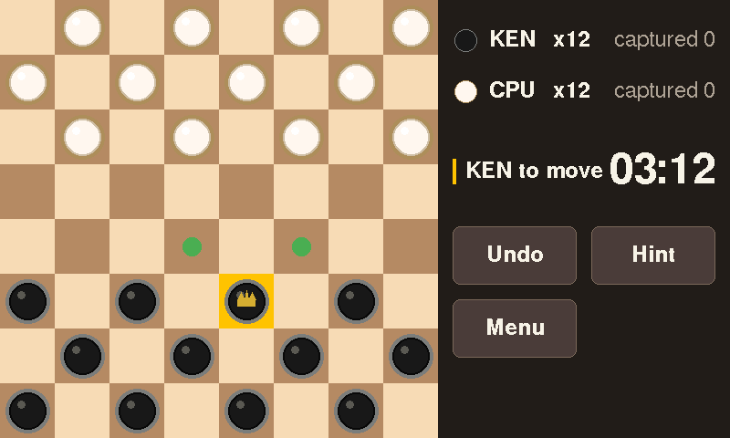
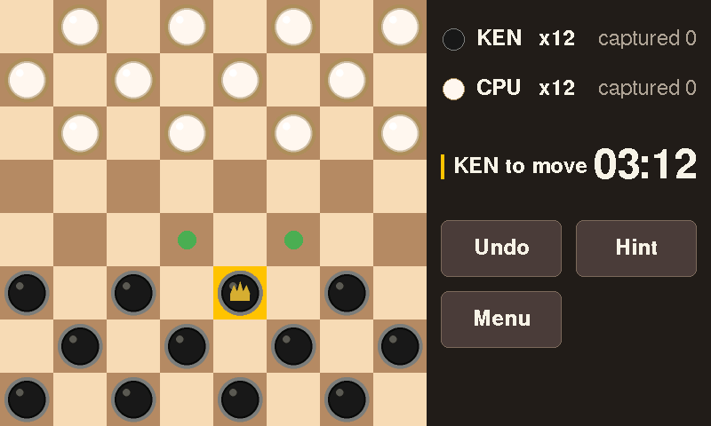

# crowboard

[](https://github.com/kennethsmitheth/crowboard/actions/workflows/ci.yml)

Touch-driven American checkers for the Elecrow CrowPanel ESP32 7.0" HMI (ESP32-S3-WROOM-1-N4R8,
800x480 RGB TFT, GT911 capacitive touch). Firmware version 0.1.0 (see [CHANGELOG.md](CHANGELOG.md)).

- Design: [docs/ARCHITECTURE.md](docs/ARCHITECTURE.md)
- Progress: roadmap issue [#44](https://github.com/kennethsmitheth/crowboard/issues/44)
- Verification: [docs/qa-report.md](docs/qa-report.md)

## Features

- **Splash** with the title, firmware version and build date. Moves on after 1.5 s or on a tap.
- **Main Menu** with Resume (only when an autosaved game exists), Play vs Computer, Two Players,
  High Scores and Settings.
- **Game Setup**. Against the computer: difficulty (Easy, Medium, Hard), whether you play Dark (who
  moves first) or Light, and your initials. Two players: the initials of both players.
- **Play vs Computer** at three difficulties. Easy picks randomly among its three best moves after a
  depth-2 search. Medium searches for up to 500 ms, and Hard for up to 2.5 s with a 1 MB transposition
  table. The computer's moves slide along their jump path, captured pieces fade out and a promoted
  king pulses.
- **Hint**: a 300 ms search outlines a suggested move in cyan for about 2 s. Hints do not change the
  score.
- **Undo**: against the computer it takes back the computer's reply and your move. In two-player games
  it takes back one ply.
- **Autosave and resume**: the game is saved after every completed move. Resume continues it after a
  power cycle or a trip to the menu. The save is erased when the game ends.
- **Two players** on one screen. Optional board flip (Settings, off by default) turns the board toward
  the side to move after each move. Each player has a count-up clock.
- **Game Over**: result, reason (no pieces left, no legal moves, 40-move rule, threefold repetition,
  move limit), a score breakdown against the computer, high-score entry with an initials keypad,
  Rematch and Main Menu.
- **High Scores**: top 10 for each difficulty and overall, with a footer of games played and won per
  difficulty and the current win streak. Games are numbered instead of dated, because there is no clock.
  A reset clears every table and the stats.
- **Settings**: brightness, forced capture, default difficulty, flip board in two-player games, a
  theme toggle (stored, see [Known gaps](#known-gaps)), reset of scores and data, restore defaults,
  and About (firmware version and build date).

Rules are American checkers: men move and capture forward, kings in all four diagonal directions,
a capture is mandatory when one exists (Settings can turn that off, and such games are not scored),
multi-jumps must be completed, and a man that reaches the far row becomes a king and ends its turn.
A game is drawn after 40 moves by each side without a capture or a man move, or after a threefold
repetition.

## Controls

Everything is touch. The board is on the left, the sidebar on the right.

- **Select**: tap one of your pieces. Its legal destinations get green dots. A piece with no legal
  move does nothing when tapped.
- **Move**: tap a green dot. The piece slides there, and the last-move squares are outlined in olive.
- **Forced capture**: when a capture exists, a red ring marks each piece that must capture, and only
  those pieces can be selected.
- **Multi-jump**: after the first landing square is tapped, the next landing square gets a dot. Tap
  each landing in turn; the whole sequence is played after the last one.
- **Cancel**: tap an empty dark square, a light square or an enemy piece, or tap the selected piece
  again.
- **Buttons**: Undo, Hint and Menu. Menu leaves the game (it is autosaved) and opens the Main Menu.
- **Ignored input**: taps on the board are ignored while the computer thinks and while a piece slides.
  The buttons still respond. After any screen change, touches are ignored for 200 ms.
- **Initials keypad**: letters only, with Del and OK. OK stays disabled until one letter is typed.

## Try it on a CrowPanel 7.0"

1. Install PlatformIO Core (`pip install platformio`, or the VS Code extension).
2. Clone this repo and plug the panel in over USB-C. It shows up as a CH340 serial device.
3. Build and flash. The first build downloads the ESP32 toolchain and takes a few minutes.

   ```
   pio run -t upload
   pio device monitor
   ```

   PlatformIO auto-detects the serial port. If it picks the wrong one, add `--upload-port <port>`
   (and `--port <port>` for the monitor), or set `upload_port` in `platformio.ini`.
4. What you should see:
   - The splash for about 1.5 s: "Crowboard Checkers", version 0.1.0 and the build date.
   - The Main Menu. On a first boot there is no Resume button.
   - Play vs Computer, Medium, Start. Make a move. The computer answers within about half a second
     on Medium, and within about 2.5 s on Hard.
   - In the serial log, one `diag` line every 5 seconds. It should end with `touch: ok` and
     `storage: nvs`. `touch: absent` or `storage: RAM-ONLY` means a hardware fault to report.
5. If something misbehaves, open an issue with the serial log (921600 baud) and the steps that led
   to it.

Touch input, the Play scene in a real game, persistence across power cycles and the robustness checks
have not been run on the panel yet. See [Verification status](#verification-status).

## Build and flash

```
pio run                # build the firmware (default environment: crowpanel7)
pio run -t upload      # flash over USB (CH340; port auto-detected)
pio device monitor     # serial output at 921600 baud
pio test -e native     # host-side Unity tests for game/, services/ and the app and ui logic
tools/format.sh --check  # clang-format check (CONTRIBUTING.md)
```

The `crowpanel7` environment sets `-DCROWBOARD_DEBUG_CMDS`, so the fault-injection commands below
are in the build. Remove that flag for a release build.

## Serial commands

The firmware reads one command per line on the serial port at 921600 baud. Type `help` to see the
list. Lines that are not recognised print a warning.

| Command | What it does |
|---|---|
| `help` | List the commands. |
| `shot` | Stream the frame buffer as RLE-coded RGB565. `tools/screenshot.py` saves it as a PNG. |
| `heap` | Print the diagnostics line now. |
| `ai [easy\|medium\|hard]` | Search the start position with that profile and print the move, depth, nodes and time. Default: medium. |
| `aibench [check N]` | Benchmark the AI on the start and a mid-game position, at fixed depth 6 and at each profile's budget. Run it from the Main Menu. Numbers are in `docs/ai-notes.md`. |
| `bench` | Rendering timing experiments (`docs/rendering-notes.md`). Blocks the main loop while it runs. |
| `anim [beam\|vsync\|raw] [seconds]` | A sliding disc through the renderer. Default: beam, 8 s, at most 120 s. `raw` shows tearing. Blocks the loop. |
| `render` | Print the renderer's statistics. |
| `slide` | Animator demo (a two-jump slide, a capture fade and a promotion pulse). Owns the screen until it ends. Go to another scene afterwards to repaint. |
| `view 0\|1\|2` | Show one of three board demo states. Go to another scene to restore the scene's screen. |
| `hud think` | Toggle the "Computer thinking..." status on the demo board. |
| `widgets` | Touch demo of every widget. Owns the screen and input until reboot. |

Debug commands, built with `-DCROWBOARD_DEBUG_CMDS` (see [Build and flash](#build-and-flash)):

| Command | What it does |
|---|---|
| `nvs corrupt <ns> <key>` | Flip one byte of a stored blob, for example `nvs corrupt settings v1`. The next boot must reject it. |
| `crash` | Software panic. The next boot logs the reset reason and the core dump summary. |
| `crash hang` | Spin the loop without feeding the watchdog. The task watchdog reboots the panel after about 10 s. |

Both `ai` and `aibench` share the AI worker with the Play scene. Typing them during a game aborts
the computer's search, so run them from a menu for clean numbers.

## Screenshots

`tools/screenshot.py` saves what the panel shows as a PNG. Close `pio device monitor` first, because
only one program can hold the port.

```
pip install -r tools/requirements.txt
python3 tools/screenshot.py --port /dev/cu.wchusbserialXXX out.png
```

A capture takes well under a second. Details are in `tools/README.md`.

The three images in `docs/images/` are the only screenshots so far:


*Bring-up screen from the first screenshot-tool capture (#7).*



*Static board mock from #19, captured from the panel. It was drawn by the `MockScreen` that has since
been removed. It is not the current Play screen.*



*The same mock board with the pre-rendered sprite pieces from #21, captured from the panel.*

**Screens with no screenshot yet:** Splash, Main Menu, Game Setup, a real game in the Play scene
(the HUD and sidebar are only shown in the mock), Game Over, High Scores and Settings. These need the
panel and `tools/screenshot.py`, and they are not in the repo.

## Verification status

Hardware was available for the renderer and AI tuning work (#20 and #18), and the images in
`docs/images/` were captured from the panel (#7, #19, #21). Everything after the renderer and AI
tuning commits is host-verified only. That covers the scenes, the Play scene, persistence, scoring,
Hint, two-player mode and the robustness work, and the fixes from the integration pass (#42).
`pio run -e crowpanel7` builds the firmware, and `pio test -e native` passes 302 test cases.

The integration pass was run without the panel. Its findings, the fixes, the manual test plan for the
next session on the panel, and the measurements still needed are all in
[docs/qa-report.md](docs/qa-report.md). Until that plan has been run, treat behaviour on the panel
as unverified. The checklists are [docs/play-qa-checklist.md](docs/play-qa-checklist.md) and
[docs/robustness-checklist.md](docs/robustness-checklist.md).

## Known gaps

- **Phantom taps (#45).** The touch controller can report taps the player did not make. The guards
  (`minPressMs`, `maxTapsPerSecond`) exist but are off. A phantom tap on a legal target plays a move,
  and one on a menu button presses it.
- **Overlay tearing (#47).** The sliding piece, the capture fade and the promotion pulse are drawn
  outside the beam-synced bands, so they may tear.
- **Autosave stall (#48).** The autosave writes NVS in the frame that ends a slide. A slow write may
  show as a hitch.
- **Menu during a slide (#49).** Opening the menu during a slide drops the move being animated, so
  Resume shows the position before it. Undo applies the move first.
- **Theme.** Settings has a Classic / Slate toggle. Only the Classic palette exists, so the setting
  is stored and changes nothing yet.
- **`Settings.firstPlayer`** is stored but never read. Game Setup decides who moves first.
- **Very long games** with many multi-jumps may not autosave (qa-report F19). Resume then restores
  an older position.

## Layout

Source follows the layered architecture in `docs/ARCHITECTURE.md` (sections 3 and 14). Dependencies
point downward only.

```
src/
  main.cpp      wiring: hal init, scene registration, frame loop
  hal/          LovyanGFX config, touch, NVS storage, scan-out, serial commands, diagnostics, AiWorker
  game/         pure C++17 checkers engine: board, moves, game state, search, notation (host-testable)
  ui/           theme, dirty-rect renderer, board view, HUD, widgets, animator
  app/          scene framework (Nav, SceneManager), scenes/
  services/     scoring, high scores, settings, autosave, stats, storage interface (host-testable)
test/           native unit tests (Unity), one directory per suite
tools/          host-side helper scripts
docs/           architecture, QA reports, checklists, measurements
```

Each `src/` subdirectory has a README describing what belongs there.

## Hardware notes

- The display pin map and timing live in `src/hal/crowpanel7_lgfx.h`.
- PSRAM is required for the frame buffer. It is configured in `platformio.ini` (memory type
  `qio_opi`, 4 MB flash).
- The partition table is `partitions.csv`: a 3 MB factory app, 64 KB NVS, 64 KB core dump, 832 KB
  LittleFS (reserved, unused) and no OTA slot. The table is in `docs/ARCHITECTURE.md` section 2.
- Build size at 0.1.0: 74,652 bytes of static RAM (22.8 %), and 507,563 bytes of flash (16.1 % of the
  app slot).
- Rendering strategy and measurements: `docs/rendering-notes.md`. AI benchmark and difficulty profiles:
  `docs/ai-notes.md`.

## Documentation

- [CHANGELOG.md](CHANGELOG.md): what 0.1.0 contains and what has been verified on the panel.
- [docs/ARCHITECTURE.md](docs/ARCHITECTURE.md): the design, as built, with the deviations from it.
- [docs/qa-report.md](docs/qa-report.md): integration findings, the manual test plan and open
  measurements.
- [docs/play-qa-checklist.md](docs/play-qa-checklist.md) and
  [docs/robustness-checklist.md](docs/robustness-checklist.md): manual checks for the panel.
- [docs/rendering-notes.md](docs/rendering-notes.md) and [docs/ai-notes.md](docs/ai-notes.md): the
  measurements behind the renderer and the AI.
- [CONTRIBUTING.md](CONTRIBUTING.md): build, formatting, branches and commit messages.
